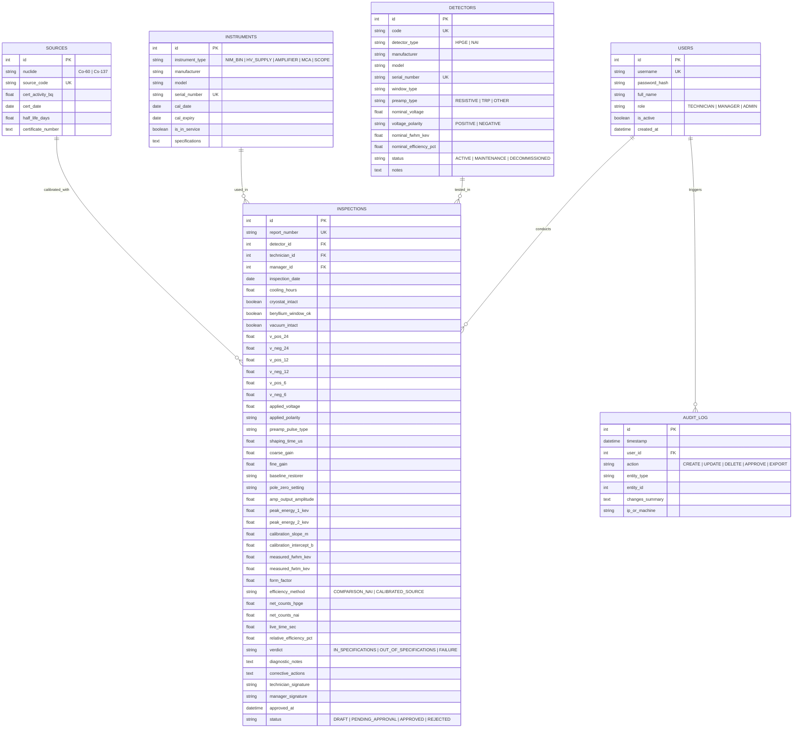

# وثيقة المعمارية الفنية لمنظومة «كاشف» (KASHIF-QA)
## Architecture & Technical Design Document

- **الإصدار:** 1.0.0-draft
- **الحالة:** معروض للاعتماد (Gate G1)
- **المنصة المستهدفة:** Python 3.10+ / PyQt6 (تطبيق مكتبي متكامل Desktop)
- **نمط التصميم:** معمارية متعددة الطبقات منفصلة الاهتمامات (Layered Clean Architecture) مستوحاة من منظومة RadRiskMap

---

## 1. القرارات التقنية الأساسية (Tech Stack Decisions)

| المكون | التقنية المختارة | سبب الاختيار |
| :--- | :--- | :--- |
| **لغة البرمجة** | Python 3.10+ | لغة رائدة عالمياً في الحسابات الفيزيائية ومعالجة البيانات والتحليل الطيفي، ومثبتة النجاح في المنظومات المعملية للمركز. |
| **إطار واجهة المستخدم (GUI)** | PyQt6 | إطار مكتبي قوي يدعم ثنائية اللغة (العربية RTL والإنجليزية LTR)، عناصر واجهة غنية، ودعم كامل لتخصيص السمات (Dark/Light QSS). |
| **قاعدة البيانات (Database)** | SQLite 3 مدمجة | خفيفة، ذاتية الاحتواء، لا تحتاج لخادم خارجي (Serverless)، ومثالية للبيئات المعملية المستقلة (Offline-First). |
| **محرك التقارير (Reports)** | ReportLab | أقوى مكتبة بايثون لبناء ملفات PDF مطابقة تماماً للمستندات المعيارية مع التحكم الكامل في الجداول والخطوط العربية وشعار المنظومة. |
| **الرسوم البيانية (Plotting)** | pyqtgraph / matplotlib | سرعة فائقة في رسم الأطياف متعددة القنوات وإشارات راسم الذبذبات (Oscilloscope signals). |
| **إطار الاختبارات (Testing)** | pytest | كتابة وتشغيل اختبارات الوحدة الآلية للنواة الفيزيائية والتحقق من المعادلات الرياضية. |

---

## 2. الهيكل الهرمي للمشروع (Folder & Module Structure)

```text
kashif/
├── core/                        # النواة الفيزيائية والمنطق المجرد (مستقلة تماماً عن الواجهة وقاعدة البيانات)
│   ├── __init__.py
│   ├── physics.py               # معادلات IAEA: حساب FWHM، معامل الشكل، الكفاءة النسبية
│   ├── decay.py                 # تصحيح الاضمحلال الإشعاعي (Co-60 و Cs-137)
│   ├── models.py                # نماذج البيانات (Pydantic / Dataclasses)
│   ├── rules.py                 # قواعد التحقق من الشروط وضوابط IAEA (Conformity Rules)
│   └── spectrum.py              # تحليل القمم الطيفية وتعيين الدقة الخطية (m x + b)
│
├── db/                          # طبقة البيانات والاتصال والتخزين
│   ├── __init__.py
│   ├── connection.py            # إدارة الاتصال بقاعدة بيانات SQLite وتفعيل الـ WAL Mode
│   ├── schema.py                # تعريف الجداول ومخطط البيانات الأساسي والـ Migrations
│   ├── repositories.py          # فئات التخزين والتعامل مع البيانات (CRUD Repositories)
│   ├── audit.py                 # محرك سجل التدقيق غير القابل للتلاعب (Audit Logger)
│   ├── auth.py                  # التوثيق، تشفير كلمات المرور (Argon2/PBKDF2)، والتحقق من الأدوار
│   └── backup.py                # إنشاء واستعادة النسخ الاحتياطية المضغوطة
│
├── reports/                     # محرك التقارير والتصدير
│   ├── __init__.py
│   ├── pdf_generator.py         # بناء تقرير الفحص الفني المطابق لـ IAEA Annex II
│   ├── excel_exporter.py        # تصدير السجلات والإحصائيات إلى ملفات Excel
│   └── labels_generator.py      # توليد بطاقات الحالة (In Specs / Out of Specs / Failure)
│
├── gui/                         # طبقة واجهة المستخدم (PyQt6)
│   ├── __init__.py
│   ├── app.py                   # نقطة الدخول وتهيئة التطبيق والـ Event Loop
│   ├── main_window.py           # النافذة الرئيسية وشريط الأدوات والتنقل
│   ├── i18n.py                  # قاموس الترجمة ثنائية اللغة (عربي / إنجليزي)
│   ├── theme.py                 # إدارة السمات المعملية وألوان الشعار و QSS
│   ├── idle_lock.py             # قفل الشاشة عند الخمول الأمني
│   │
│   ├── views/                   # الشاشات الرئيسية
│   │   ├── dashboard_view.py    # لوحة المتابعة الإحصائية وحالة الكواشف والتنبيهات
│   │   ├── detectors_view.py    # شاشة إدارة سجل الكواشف
│   │   ├── instruments_view.py  # شاشة إدارة أجهزة الفحص وسلة NIM
│   │   ├── sources_view.py      # شاشة سجل المصادر المشعة مع حاسبة الاضمحلال
│   │   ├── history_view.py      # شاشة استعراض وأرشفة الفحوصات والتقارير
│   │   └── audit_view.py        # شاشة سجل التدقيق وإدارة المستخدمين
│   │
│   ├── wizards/                 # معالجات الفحص الإرشادية خطوة بخطوة
│   │   ├── hpge_wizard.py       # معالج فحص كاشف الجرمانيوم ذو الـ 5 مراحل
│   │   └── nai_wizard.py        # معالج فحص كاشف يوديد الصوديوم
│   │
│   ├── widgets/                 # مكونات الواجهة المخصصة
│   │   ├── spectrum_plot.py     # ويدجت رسم الطيف والقمم وحساب FWHM
│   │   ├── pulse_scope.py       # ويدجت عرض إشارات راسم الذبذبات التفاعلية
│   │   └── status_badge.py      # شارات الحالة الملونة
│   │
│   └── assets/                  # الموارد البصرية
│       ├── kashif_logo.png      # شعار المنظومة المعتمد
│       └── diagrams/            # مخططات التوصيلات المستخرجة من وثيقة IAEA
│
├── tests/                       # اختبارات الوحدة والتكامل الآلية
│   ├── test_physics.py          # اختبارات دقة معادلات IAEA
│   ├── test_decay.py            # اختبارات دقة حسابات الاضمحلال الإشعاعي
│   ├── test_db.py               # اختبارات قاعدة البيانات ومستودعات التخزين
│   ├── test_audit.py            # اختبارات سجل التدقيق وصلاحيات الأدوار
│   └── test_reports.py          # اختبارات سلامة توليد تقارير الـ PDF
│
├── docs/                        # وثائق المنظومة
│   ├── requirements.md
│   ├── architecture.md
│   ├── tasks.md
│   └── adr/
│
├── run.py                       # ملف التشغيل الرئيسي للمنظومة
├── requirements.txt             # متطلبات بايثون
└── PROJECT_STATE.md             # ملف الحالة المحدث للمشروع
```

---

## 3. مخطط قاعدة البيانات (Database Schema)

تستخدم المنظومة محرك **SQLite** مع تفعيل وضع القيود الخارجية `PRAGMA foreign_keys = ON;` ووضع السجل السريع `PRAGMA journal_mode = WAL;`.



---

## 4. تدفق البيانات وسير العمل الفني (Data Flow & Technical Workflow)

1. **التهيئة والتحقق:**  
   يقوم الفني باختيار الكاشف المراد فحصه من السجل، ويقوم النظام تلقائياً بملء البيانات الاسمية (جهد التشغيل الاسمي، القطبية، نوع المضخم).
2. **المرحلة الأولى (الحاوية والتبريد):**  
   إدخال زمن التبريد والتأكد من سلامة النافذة والفراغ؛ في حال اكتشاف علامات انهيار الفراغ (تندّي أو ثلج)، يتم إيقاف الفحص وتحديد الحالة تلقائياً كـ `FAILURE`.
3. **المرحلة الثانية (المضخم الأولي والجهد العالي):**  
   قياس جهود سلة NIM، وتأكيد القطبية، ومتابعة الرفع التدريجي للجهد العالي (100V كل 10 ثوانٍ) وتسجيل نبضة المضخم الأولي.
4. **المرحلة الثالثة (المضخم الرئيسي):**  
   تسجيل زمن التشكيل والكسب وضبط الـ Pole-Zero لمنع الـ Undershoot/Overshoot.
5. **المرحلة الرابعة (معايرة MCA والدقة):**  
   إدخال قراءات الكوبالت-60، وحساب المنظومة التلقائي لـ FWHM ومعامل الشكل $\text{FWTM}/\text{FWHM}$. التحقق التلقائي من أن المعامل $< 1.9$ ودقة القمة $\approx 1.9\text{ keV}$.
6. **المرحلة الخامسة (الكفاءة النسبية):**  
   اختيار طريقة الحساب (بالمقارنة مع NaI أو بمصدر الكوبالت-60 المعاير بعد احتساب اضمحلاله التلقائي)، وحساب نسبة الكفاءة المئوية.
7. **الاعتماد والتقارير:**  
   مراجعة مسؤول الجودة للتقرير وإصدار الاعتماد والتوقيع الرقمي وتوليد وثيقة PDF الرسمية وفق IAEA Annex II.

---

## 5. سجل القرارات المعمارية المعتمدة (ADR Index)

- **ADR-001:** اختيار بايثون و PyQt6 كمنصة مكتبية مستقلة (Desktop Offline) لضمان العمل داخل المعامل المغلقة وتوفير أقصى دقة حسابية.
- **ADR-002:** استخدام SQLite مع تفعيل نمط WAL لضمان موثوقية حفظ البيانات وسرعة الاستعلامات دون حاجة لإدارة خادم.
- **ADR-003:** فصل النواة الفيزيائية (`core/`) عن واجهات المستخدم لضمان خضوع كافة الحسابات لاختبارات آلية صارمة ومستقلة بنسبة 100%.
- **ADR-004:** اعتماد محرك ReportLab لتوليد تقارير PDF مطابقة بدقة بكسلية لاستمارات الوكالة الدولية للطاقة الذرية IAEA Annex II.
