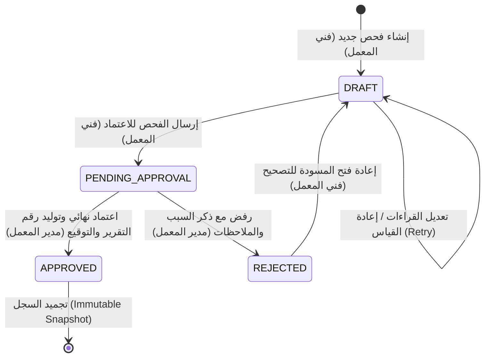

# جدول قواعد القرار والتحقق الفني لمنظومة «كاشف» (Decision Rules Matrix)
## KASHIF-QA Technical Conformity & Verdict Rules

- **الإصدار:** 1.0.0
- **المرجعية:** وثيقة الوكالة الدولية للطاقة الذرية IAEA Procedure Nº: MRNI-507 (Rev. D0)
- **القاعدة الحاكمة:** كل عتبة أو نسبة لا يوجد لها نص صريح ومباشر في وثيقة IAEA تُعلّم بالوسم `[TBC: يحتاج تأكيد المهندس]` مع اقتراح مبدئي واضح.

---

## 1. مسار حالات الفحص والفصل بين المهام (Workflow & Separation of Duties)

### 1.1 آلة حالات الفحص (State Machine)
يمر أي فحص فني بالمسار الصارم التالي:

### 1.2 قواعد فصل المهام (Separation of Duties Rules)
- **RULE-SEC-01 (منع الاعتماد الذاتي):** لا يجوز للمستخدم الذي أجرى الفحص وسجل قراءاته (`technician_id`) أن يقوم باعتماد نفس الفحص (`technician_id != approver_id`).  
  *المرجع:* IAEA MRNI-507 Annex I (Workflow: Personnel creates report $\rightarrow$ Manager verifies and checks).  
  *حالة التأكيد:* `CONFIRMED`.
- **RULE-SEC-02 (حظر اعتماد مدير النظام):** لا يملك مدير النظام التقني (`ADMIN`) صلاحية الاعتماد الفني للفحوصات المعملية، وتقتصر صلاحيته على الإدارة التقنية والنسخ الاحتياطي والمستخدمين، إلا إذا كان يمتلك حساباً مستقلاً بدور مدير معمل (`LAB_MANAGER`).  
  *حالة التأكيد:* `CONFIRMED`.
- **RULE-SEC-03 (تجميد السجل المعتمد):** بمجرد وصول الفحص إلى حالة `APPROVED`، يُقفل السجل نهائياً وتُنشأ لقطة مجمدة (`snapshot_json`) تمنع أي تعديل أو حذف لاحق. في حال اكتشاف خطأ في فحص معتمد، يتم إصدار فحص تصحيحي جديد مرتبط به (`superseded_by_id`).  
  *حالة التأكيد:* `CONFIRMED`.

---

## 2. مصفوفة قواعد القرار لكواشف الجرمانيوم (HPGe Decision Matrix)

| المعرف (Rule ID) | المرحلة / الفحص | الشرط المنطقي (Condition) | الحكم الناتج (Verdict / Action) | المرجع في IAEA MRNI-507 | حالة التأكيد (Status) | الإجراء الفني المطلوب |
| :--- | :--- | :--- | :--- | :--- | :--- | :--- |
| **R-HPGE-01** | سلامة الحاوية والنافذة | نافذة البريليوم مكسورة (`window_status == BROKEN`) أو الحاوية مصدومة بعنف | **FAILURE** | ص 7 البند 3.4.2 والشكل 2 | `CONFIRMED` | إيقاف الفحص فوراً، عدم تشغيل الجهد، وإرسال الكاشف للصيانة وتثبيت ملصق عطل (FAILURE). |
| **R-HPGE-02** | سلامة نافذة البريليوم | خدش سطحي غير نافذ (`window_status == SCRATCHED`) | **OUT_OF_SPEC** | ص 7 البند 3.4.2 | `[TBC: يحتاج تأكيد المهندس - اقتراح: السماح بإكمال الفحص بحذر مع مراقبة تفريغ الحاوية]` | مراقبة ضغط التفريغ بدقة والتأكد من عدم تسرب الهواء. |
| **R-HPGE-03** | مدة التبريد بالنيتروجين | مدة التبريد في النيتروجين أقل من 6 ساعات (`cooling_hours < 6.0`) | **WAIT / BLOCK** | ص 7 البند 3.4.3 | `CONFIRMED` | **حظر رفع الجهد العالي (HV)** والانتظار حتى اكتمال 6 ساعات على الأقل. (ليست حالة عطل). |
| **R-HPGE-04** | التفريغ الفراغي للحاوية | ظهور تندّي مائي أو تكون طبقة ثلج/صقيع خارجي على الحاوية (`cryostat_wet_or_frozen == TRUE`) | **FAILURE** | ص 7 البند 3.4.3 والشكل 4 | `CONFIRMED` | وجود مشكلة تفريغ خطيرة (Vacuum Leak)، منع تشغيل الجهد فوراً وتثبيت ملصق عطل (FAILURE). |
| **R-HPGE-05** | جهود سلة NIM القياسية | أي جهد من الجهود الأربعة الأساسية ($\pm 24\text{V}, \pm 12\text{V}$) يخرج عن سماحية $\pm 5\%$ من القيمة الاسمية | **OUT_OF_SPEC** | ص 9 البند 3.5.1 | `[TBC: يحتاج تأكيد المهندس - اقتراح: سماحية جهود سلة NIM هي ±5%]` | فحص وإصلاح مجهز قدرة سلة NIM قبل توصيل المضخم لتفادي احتراق الدوائر. |
| **R-HPGE-06** | قطبية الجهد العالي | قطبية مجهز الجهد العالي لا تطابق القطبية المدونة على ملصق الكاشف في السجل | **BLOCK** | ص 10 البند 3.5.5 | `CONFIRMED` | حظر رفع الجهد منعاً باتاً؛ عكس قطبية الكاشف شبه الموصل يؤدي لتلف بلورة الجرمانيوم نهائياً. |
| **R-HPGE-07** | معدل رفع الجهد العالي | رفع الجهد العالي بمعدل يزيد عن 100V كل 10 ثوانٍ | **BLOCK / WARNING** | ص 11 البند 3.5.14 | `CONFIRMED` | إيقاف الرفع والتأكيد على التدرج الآمن بمعدل خطوة 100V كل 10 ثوانٍ لمنع الانهيار الحراري. |
| **R-HPGE-08** | إشارة المضخم الأولي | عدم ظهور أي إشارة على راسم الذبذبات مع الجهد أو بدونه | **FAILURE** | ص 11 البند 3.5.12 و 3.5.13 | `CONFIRMED` | المضخم الأولي لا يعمل؛ إيقاف الفحص وخفض الجهد تدريجياً وإرسال المضخم للصيانة (ص 11). |
| **R-HPGE-09** | تعويض القطب والصفر (P/Z) | وجود تشوه في نبضة المضخم (Overshoot أو Undershoot) لمضخم التغذية بالمقاومة | **OUT_OF_SPEC** | ص 14 البند 3.6.7 والشكل 10 | `CONFIRMED` | ضبط مقاومة الـ Pole-Zero في المضخم الرئيسي حتى استواء خط الأساس دون ارتداد علوي أو سفلي. |
| **R-HPGE-10** | معدل العد الإجمالي في MCA | إجمالي معدل النبضات يرتفع عن 2000 نبضة/ثانية (`total_cps > 2000`) أو زمن الموت يتجاوز 5% | **OUT_OF_SPEC / WARNING** | ص 14 البند 3.7.2 (حد 2000 cps منصوص عليه؛ حد زمن الموت 5% غير وارد في الوثيقة) | `CONFIRMED` لحد 2000 cps فقط؛ `[TBC: يحتاج تأكيد المهندس - اقتراح: زمن الموت ≤ 5%]` | زيادة المسافة بين مصدر الكوبالت-60 والكاشف لتقليل معدل العد إلى $< 2000\text{ cps}$ لمنع تراكم النبضات وزمن الموت. |
| **R-HPGE-11** | إحصاء مساحة القمة الطيفية | المساحة الصافية لقمة $1332.5\text{ keV}$ أقل من 10,000 نبضة (`net_counts < 10000`) | **WAIT / INSUFFICIENT_DATA** | ص 14 البند 3.7.3 | `CONFIRMED` | تمديد زمن القياس الحي (Live Time) حتى تتجاوز المساحة الصافية 10,000 نبضة لضمان شك إحصائي $< 1\%$. |
| **R-HPGE-12A** | دقة التحليل الطاقي (FWHM) - نجاح | $\text{FWHM}_{\text{measured}} \le 1.10 \times \text{FWHM}_{\text{nominal}}$ (أو $\le 1.9\text{ keV}$ في حال عدم توفر الاسمي) | **PASS** | ص 15 البند 3.7.7 | `[TBC: يحتاج تأكيد المهندس - اقتراح: نسبة 110% من الاسمي]` | دقة ممتازة ومطابقة للمواصفات المعملية القياسية. |
| **R-HPGE-12B** | دقة التحليل الطاقي (FWHM) - خروج عن المواصفات | $1.10 \times \text{FWHM}_{\text{nominal}} < \text{FWHM} \le 1.25 \times \text{FWHM}_{\text{nominal}}$ (أو بين $1.9\text{ keV}$ و $2.4\text{ keV}$) | **OUT_OF_SPEC** | ص 15 البند 3.7.7 | `[TBC: يحتاج تأكيد المهندس - اقتراح: المدى 110%-125%]` | خفض الجهد تدريجياً، تجفيف المضخم الأولي بهواء دافئ، فحص كابلات BNC وإعادة القياس (حلقة Retry). |
| **R-HPGE-12C** | دقة التحليل الطاقي (FWHM) - عطل فني | $\text{FWHM}_{\text{measured}} > 1.25 \times \text{FWHM}_{\text{nominal}}$ (أو $> 2.4\text{ keV}$) بعد محاولة الإجراء التصحيحي | **FAILURE** | ص 15 البند 3.7.7 و ص 17 البند 5.2 | `[TBC: يحتاج تأكيد المهندس - اقتراح: تجاوز 125% عطل]` | تدهور جسيم في بلورة الكاشف أو الضجيج الإلكتروني؛ إيقاف تشغيل الكاشف وتثبيت ملصق FAILURE. |
| **R-HPGE-13** | معامل شكل النبضة (Form Factor) | نسبة $\text{FWTM} / \text{FWHM} < 1.90$ عند قمة الكوبالت $1332.5\text{ keV}$ | **PASS** | ص 15 البند 3.7.8 | `CONFIRMED` | شكل القمة غاوسي متناسق وسليم. |
| **R-HPGE-14** | معامل شكل النبضة (Form Factor) | نسبة $\text{FWTM} / \text{FWHM} \ge 1.90$ عند قمة الكوبالت $1332.5\text{ keV}$ | **OUT_OF_SPEC** | ص 15 البند 3.7.8 | `CONFIRMED` | وجود ذيل غير متماثل في القمة (Peak Tailing/Incomplete charge collection)؛ يتطلب فحص الجهد وتيار التسريب. |
| **R-HPGE-15A** | الكفاءة النسبية للكاشف - نجاح | $\text{Eff}_{\text{measured}} \ge 0.95 \times \text{Eff}_{\text{nominal}}$ | **PASS** | ص 16 البند 3.8 | `[TBC: يحتاج تأكيد المهندس - اقتراح: لا تقل عن 95% من الكفاءة الاسمية]` | الكفاءة ممتازة ومطابقة للمواصفات. |
| **R-HPGE-15B** | الكفاءة النسبية للكاشف - انخفاض طفيف | $0.80 \times \text{Eff}_{\text{nominal}} \le \text{Eff}_{\text{measured}} < 0.95 \times \text{Eff}_{\text{nominal}}$ | **OUT_OF_SPEC** | ص 16 البند 3.8 | `[TBC: يحتاج تأكيد المهندس - اقتراح: بين 80% و 95%]` | خروج طفيف عن المواصفات؛ التحقق من دقة المسافة الهندسية ($25\text{ cm}$) ومحاذاة محور التناظر. |
| **R-HPGE-15C** | الكفاءة النسبية للكاشف - عطل | $\text{Eff}_{\text{measured}} < 0.80 \times \text{Eff}_{\text{nominal}}$ | **FAILURE** | ص 16 البند 3.8 و ص 17 البند 5.2 | `[TBC: يحتاج تأكيد المهندس - اقتراح: أقل من 80% عطل]` | انخفاض حاد في حجم البلورة الحساس (Dead layer increase)؛ تثبيت ملصق عطل وإحالته للصيانة. |

---

## 3. مصفوفة قواعد القرار لكواشف يوديد الصوديوم (NaI(Tl) Decision Matrix)

| المعرف (Rule ID) | الفحص / المتغير | الشرط المنطقي (Condition) | الحكم الناتج (Verdict) | المرجع الفني القياسي | حالة التأكيد (Status) | الإجراء المطلوب |
| :--- | :--- | :--- | :--- | :--- | :--- | :--- |
| **R-NAI-01** | استقرار مجهز الجهد العالي للـ PMT | تذبذب جهد التغذية للأنبوب المضاعف الضوئي عن القيمة الموصى بها بنسبة $> 2\%$ | **OUT_OF_SPEC** | MRNI-504 البند 3.2.1 (تنظيم < 0.01% وتموج < 100 mV) | `CONFIRMED` للتنظيم والتموج؛ سماحية 2% في هذا الصف غير واردة `[TBC: يحتاج تأكيد المهندس - اقتراح: استبدالها بحدي MRNI-504]` | فحص وضبط وحدة الجهد العالي واستقرار تيار المقسم الضوئي. |
| **R-NAI-02A** | الدقة الطاقية (%R) عند قمة السيزيوم $661.5\text{ keV}$ | $\%R \le 7.5\%$ لكاشف $3'' \times 3''$ | **PASS** | معيار الصناعة القياسي لكواشف الوميض | `[TBC: يحتاج تأكيد المهندس - اقتراح: 7.5% حد النجاح]` | كاشف ممتاز ومطابق للمواصفات المعملية الومضية. |
| **R-NAI-02B** | الدقة الطاقية (%R) عند قمة السيزيوم $661.5\text{ keV}$ | $7.5\% < \%R \le 9.0\%$ لكاشف $3'' \times 3''$ | **OUT_OF_SPEC** | معيار الصناعة القياسي لكواشف الوميض | `[TBC: يحتاج تأكيد المهندس - اقتراح: بين 7.5% و 9.0%]` | تراجع في دقة البلورة أو الكفاءة الضوئية؛ إعادة معايرة الجهد والتحقق من التوصيل البصري. |
| **R-NAI-02C** | الدقة الطاقية (%R) عند قمة السيزيوم $661.5\text{ keV}$ | $\%R > 9.0\%$ لكاشف $3'' \times 3''$ | **FAILURE** | معيار الصناعة القياسي لكواشف الوميض | `[TBC: يحتاج تأكيد المهندس - اقتراح: أعلى من 9.0% عطل]` | تلف في بلورة الوميض (تغير لون البلورة Yellowing/Hydration) أو عطل PMT؛ تثبيت ملصق FAILURE. |
| **R-NAI-03** | استقرار الكسب الطيفي والانجراف (Gain Drift) | تحرك موضع قمة السيزيوم (Centroid Drift) بأكثر من قناتين خلال ساعتين قياس | **OUT_OF_SPEC** | معايير الاستقرار لمطيافية NaI | `[TBC: يحتاج تأكيد المهندس - اقتراح: انجراف > 2 قنوات]` | فحص التثبيت الحراري للمعمل واستقرار قاعدة الأنبوب الضوئي. |

---

## 4. قواعد صلاحية الأجهزة والمصادر (Instruments & Sources Validity Rules)

| المعرف (Rule ID) | الفحص | الشرط المنطقي | السلوك المعتمد في المنظومة | المرجع في IAEA MRNI-507 | حالة التأكيد |
| :--- | :--- | :--- | :--- | :--- | :--- |
| **R-INST-01** | سريان شهادة معايرة الجهاز | تاريخ اليوم يقع بعد تاريخ انتهاء شهادة المعايرة (`cal_expiry < today`) لأي جهاز مستخدم (HV, NIM, Amp, MCA) | **تحذير شديد (WARNING)** مع إلزام الفني بتسجيل تبرير فني، ووسم التقرير بحالة "جهاز منتهي المعايرة"، وتسجيل الحدث في سجل التدقيق (انظر السؤال المفتوح 5). | ص 6 البند 3.2 ("All instruments must have a valid calibration certificate") | `CONFIRMED` (الوجوب من الوثيقة، والسلوك «تحذير مع تبرير» بقرار مدير المشروع رقم 5) |
| **R-INST-02** | تموج مجهز الجهد العالي (Ripple) | نسبة التموج في مجهز الجهد العالي تتجاوز 100 mV (`ripple_mv > 100`) أو تنظيم الجهد أسوأ من 0.01% | **OUT_OF_SPEC** | ص 6 البند 3.2.2 | `CONFIRMED` |
| **R-INST-03** | نطاق زمن تشكيل المضخم | المضخم الطيفي لا يدعم أزمنة تشكيل في المدى $3\,\mu\text{s} - 12\,\mu\text{s}$ أو تم ضبطه على أقل من $4\,\mu\text{s}$ أثناء فحص الجرمانيوم | **BLOCK / INVALID_SETTING** | ص 6 البند 3.2.3 وص 12 البند 3.6.2 | `CONFIRMED` |
| **R-SRC-01** | فعالية مصدر المعايرة | الفعالية اللحظية المحسوبة بعد الاضمحلال تبتعد كثيراً عن القيمة الموصى بها ($\approx 37,000\text{ Bq} \pm 50\%$) | **WARNING** | ص 7 البند 3.3 | `[TBC: يحتاج تأكيد المهندس - اقتراح: تحذير لتفادي زيادة زمن الموت أو ضعف الإحصاء]` |

---

## 5. بروتوكول حلقة إعادة القياس بعد الإجراء التصحيحي (Retry Loop Protocol)

1. إذا أسفرت أي مرحلة عن حالة `OUT_OF_SPEC` (مثل ارتفاع FWHM أو سوء ضبط P/Z):
   - يمنع النظام الانتقال لإصدار التقرير النهائي قبل أن يختار المستخدم إما:
     - **أ) تنفيذ إجراء تصحيحي وإعادة القياس (Corrective Action & Retry):** يسجل الفني الإجراء المتخذ (مثل: تجفيف بهواء دافئ، استبدال كابل BNC، إعادة ضبط مقاومة P/Z)، ثم يُدخل القراءات الجديدة في محاولة جديدة تُحفظ في جدول `measurement_retries` محتفظة بالقراءات السابقة لغرض التدقيق.
     - **ب) الإبقاء على النتيجة وتأكيد حالة OUT_OF_SPEC:** مع إرفاق تعليل فني لرفعه لمدير المعمل ليتخذ قرار القبول المشروط أو التوجيه بالصيانة.
2. إذا أسفرت أي مرحلة عن حالة **FAILURE** حرجة (مثل كسر نافذة البريليوم أو فقدان الفراغ):
   - تُقفل حلقة القياس فوراً، وتُحظر المراحل اللاحقة، ويصدر النظام مباشرة تقرير عدم مطابقة وتوصية إحالة للصيانة (Maintenance Ticket).
