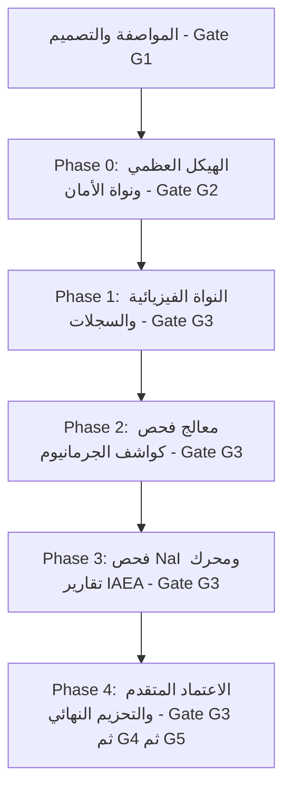

# خطة المهام والمراحل لمنظومة «كاشف» (KASHIF-QA)
## Phased Implementation Roadmap & Tasks

- **الإصدار:** 1.1.0 (محدث وفق مراجعة ما قبل بوابة G1)
- **الحالة:** معروض للاعتماد النهائي (Gate G1)
- **منهجية العمل:** دورات بناء مغلقة (Phases)؛ لا يبدأ أي Phase حتى يجتاز سابقه البوابة المحددة صراحة (وفق ميثاق بوابات الجودة [docs/gates.md](file:///d:/مشروع%20برنامج%20مراجعة%20كواشف/docs/gates.md)).
- **الفرع النشط:** `docs/g1-corrections` (التحضير للبوابة G1)

---

## ملخص المراحل والمسار الزمني (Phases Summary)

| المرحلة | عنوان المرحلة | النطاق والمخرجات الرئيسية | البوابة المستهدفة |
| :--- | :--- | :--- | :--- |
| **Phase 0** | الهيكل العظمي، الأمان الأولي، والبنية الأساسية | هيكل الحزم `kashif/`، محرك SQLite مع الـ Migrations، سجل التدقيق المنيع بالهاش السلسلي، معالج الأخطاء `kashif_error.log`، نافذة PyQt6 بشعار كاشف، وخدمة التوثيق الأولية. | **Gate G2** |
| **Phase 1** | النواة الفيزيائية، محرك القواعد، وسجلات المعمل | نماذج Pydantic، مكتبة معادلات IAEA، حاسبة الاضمحلال، محرك قواعد القرار `rules.py`، شاشات إدارة الكواشف والأجهزة والمصادر، واختبارات الوحدة بنسبة تغطية $\ge 90\%$. | **Gate G3** |
| **Phase 2** | معالج فحص كواشف الجرمانيوم التفاعلي | معالج الفحص الخماسي لوثيقة IAEA، مؤقت رفع الجهد الآمن، ويدجت راسم النبضات `pulse_scope.py`، حسابات FWHM والمعايرة الخطية، وإدارة المحاولات التصحيحية `retries`. | **Gate G3** |
| **Phase 3** | فحص كواشف NaI ومحرك تقارير IAEA الرسمية | مسار فحص كواشف NaI(Tl)، محرك تقارير PDF عبر ReportLab مع خط Amiri ودعم RTL، تصدير Excel، ومولد ملصقات الحالة الفنية الملونة. | **Gate G3** |
| **Phase 4** | الأمان المتقدم، التحزيم، والتشطيب النهائي | الاعتماد الرقمي للمدير وتجميد الـ Snapshots، قفل الشاشة عند الخمول، النسخ الاحتياطي المشفر، لوحة التحكم، واختبارات `pytest-qt`، وتحزيم Windows (PyInstaller + Inno Setup). | **Gate G3 ثم G4 ثم G5** |

---

## Phase 0: الهيكل العظمي، الأمان الأولي، والبنية الأساسية (Foundation & Core Security)

- **معايير الدخول (Entry Criteria):** اعتماد وثائق المواصفات في فرع `docs/g1-corrections` واجتياز بوابة **G1** صراحة.
- **الفرع المخصص للتنفيذ:** `phase-0-skeleton`

### المهام التفصيلية:
- [ ] **TASK-0.1: إعداد بيئة التطوير وحزم الاعتماديات الموحدة:**
  - إنشاء ملف `requirements.txt` محدثاً بالحزم المعتمدة في المعمارية: `PyQt6>=6.5.0`، `pyqtgraph>=0.13.0`، `matplotlib>=3.7.0`، `pydantic>=2.0.0`، `argon2-cffi>=23.1.0`، `reportlab>=4.0.0`، `arabic-reshaper>=3.0.0`، `python-bidi>=0.4.2`، `openpyxl>=3.1.0`، `pytest>=7.4.0`، `pytest-qt>=4.2.0`، `pytest-cov>=4.1.0`.
  - التحقق من تثبيت بيئة بايثون الافتراضية بنجاح.
  - *معيار القبول:* أمر `pip check` ينتهي بنجاح دون أي تعارض في الحزم.
- [ ] **TASK-0.2: إنشاء البنية الهيكلية الكاملة لحزم `kashif/` والأصول المضمنة:**
  - إنشاء حزم: `kashif/core/`، `kashif/services/`، `kashif/db/`، `kashif/reports/`، `kashif/gui/views/`، `kashif/gui/wizards/`، `kashif/gui/widgets/`، `kashif/gui/assets/fonts/`، `tests/`، ومجلد `docs/`.
  - نسخ شعار المنظومة المعتمد `kashif_logo.png` إلى `kashif/gui/assets/`.
  - تنزيل وتضمين ملفات خط Amiri الطباعي المفتوح المصدر (`Amiri-Regular.ttf` و `Amiri-Bold.ttf`) داخل `kashif/gui/assets/fonts/`.
  - *معيار القبول:* استيراد حزمة `import kashif` يعمل بنجاح في بيئة بايثون وتوفر ملفات الخطوط والشعار.
- [ ] **TASK-0.3: محرك قاعدة بيانات SQLite ونظام الـ Migrations وسجل التدقيق المنيع:**
  - بناء وحدة الاتصال `kashif/db/connection.py` مع تفعيل `PRAGMA foreign_keys = ON;` و `PRAGMA journal_mode = WAL;`.
  - بناء محرك إدارة ترقيات المخطط `kashif/db/migrations.py` وجدول `schema_migrations`.
  - تطبيق الترقية الأولى (Migration 001): إنشاء جدول `users`، وجدول `audit_log` المزود بسلسلة الهاش التشفيرية (`prev_hash` و `row_hash` عبر SHA-256) مع Triggers لمنع `UPDATE` و `DELETE` نهائياً.
  - *معيار القبول:* اجتياز محاولة تعديل أو حذف في جدول `audit_log` بالرفض الصارم عبر Trigger مع رمي استثناء مبرهن.
- [ ] **TASK-0.4: خدمة الأمان الأولية وإدارة المستخدم الافتراضي:**
  - بناء وحدة `kashif/services/security.py` لتجزئة كلمات المرور عبر Argon2id (مع بديل PBKDF2 القياسي).
  - إنشاء أول مستخدم افتراضي بصلاحية مدير نظام (`admin`) عند أول تشغيل مع تعيين راية إجبار تغيير كلمة المرور عند أول دخول (`must_change_password = TRUE`).
  - توفير دالة استعادة كلمة المرور محلياً للطوارئ عبر مفتاح استعادة رقمي (Master Recovery Key).
  - *معيار القبول:* إمكانية توثيق المستخدم وتجزئة كلمة المرور بنجاح وتسجيل حدث `LOGIN` في جدول `audit_log`.
- [ ] **TASK-0.5: النافذة الرئيسية بالسمة المعملية وإدارة الاستثناءات العامة:**
  - بناء معالج الاستثناءات العام في `kashif/gui/app.py` لاعتراض أي خطأ غير معالج وتسجيله في ملف `kashif_error.log` وعرض تنبيه مهذب للمستخدم.
  - بناء النافذة الرئيسية `kashif/gui/main_window.py` بالسمة المعملية الفاخرة مستوحاة من ألوان الشعار (`#0B132B`, `#00F2FE`)، متضمنة الشعار المعتمد، ورقم الإصدار `0.1.0-dev`، وشريط حالة يعرض الاتصال بقاعدة البيانات واسم المستخدم النشط.
  - *معيار القبول:* تشغيل التطبيق عبر `python run.py` يفتح النافذة بسلاسة ويعرض الشعار دون أخطاء.
- [ ] **TASK-0.6: اختبارات التكامل الأولية لـ Phase 0:**
  - كتابة اختبارات `tests/test_db.py` لاختبار سلامة الاتصال، تطبيق الـ Migrations، قفل التعديل في سجل التدقيق، وتشفير كلمات المرور.
  - *معيار القبول:* اجتياز الاختبارات بنسبة نجاح 100% عبر `pytest tests/test_db.py`.

- **معايير خروج Phase 0 وبوابة G2:**
  - التطبيق يبني ويفتح وتظهر النافذة والشعار ورقم الإصدار.
  - قاعدة بيانات SQLite تعمل بنجاح وسجل التدقيق مفعل بحماية التريجرز.
  - المستخدم يقوم بالتقاط صورة فعلية لواجهة البرنامج التشغيلية واعتمادها.
  - تحديث ملف `PROJECT_STATE.md` وإعلان اجتياز بوابة **G2**.

---

## Phase 1: النواة الفيزيائية، محرك القواعد، وسجلات المعمل (Core Physics & Registry)

- **معايير الدخول:** اكتمال Phase 0 واجتياز بوابة **G2** صراحة.
- **الفرع المخصص للتنفيذ:** `phase-1-physics-registry`

### المهام التفصيلية:
- [ ] **TASK-1.0a: واجهة الدخول وإنشاء المسؤول الأول (على نمط RadRiskMap):**
  - عند أول تشغيل: حوار «إنشاء المسؤول الأول» يختار فيه المستخدم الاسم والاسم المعروض وكلمة مرور مؤكدة (حد أدنى للطول `[TBC: يحتاج تأكيد المهندس - اقتراح: 10 أحرف]`). لا كلمة افتراضية أو مولَّدة. يُستبدل بهذا الحوار الحالي لعرض كلمة المرور المؤقتة، ويبقى مفتاح الاستعادة يُعرض مرة واحدة بعد إنشاء الحساب.
  - `LoginDialog`: شعار واسم المنظومة، اسم المستخدم (قائمة المستخدمين النشطين)، كلمة المرور، خيار «تذكّر اسم المستخدم» (الاسم فقط، لا كلمة المرور).
  - قفل بعد 5 محاولات فاشلة متتالية لمدة `[TBC: يحتاج تأكيد المهندس - اقتراح: 5 دقائق]`، يُخزَّن العداد في القاعدة ويُسجَّل في `audit_log`.
  - فرض `must_change_password`: بعد الدخول تظهر شاشة تغيير كلمة المرور قبل أي شاشة أخرى.
  - الخروج (Logout) يعيد إلى نافذة الدخول.
  - *معيار القبول:* اختبارات آلية تغطي: الإنشاء الأول، دخول صحيح وخاطئ، القفل بعد 5 محاولات وانتهاؤه، حساب معطّل، وفرض تغيير كلمة المرور؛ ومعاينة يدوية بلقطة شاشة.
- [ ] **TASK-1.0b: الجلسة والصلاحيات وإدارة المستخدمين (منقولة جزئياً من TASK-4.2):**
  - كائن `Session` يحمل المستخدم ودوره ودالة `can(permission)`، ويُمرَّر لكل الشاشات، وتُخفى أو تُعطَّل الإجراءات غير المسموحة حسب الدور (`TECHNICIAN` / `LAB_MANAGER` / `ADMIN`).
  - شاشة مستخدمين لـ `ADMIN`: إضافة مستخدم بدور، تعطيل/تفعيل، إعادة تعيين كلمة المرور (مع `must_change_password`)، وكلها مسجلة في `audit_log`.
  - قفل الخمول `idle_lock.py` (منقول من TASK-4.3): قفل الواجهة بعد مدة قابلة للضبط وطلب كلمة المرور للاستئناف.
  - *معيار القبول:* اختبارات الصلاحيات لكل دور؛ ولا يستطيع أي دور تنفيذ إجراء خارج صلاحياته؛ ولا يعمل القفل بدون كلمة المرور.
- [ ] **TASK-1.0c: تطبيق الهوية البصرية (`docs/visual-identity.md`):**
  - تحويل رموز الألوان والمسافات والأنصاف إلى `theme.py` (QSS) بوضعين فاتح وداكن، الفاتح افتراضياً.
  - ألوان الحالات (مطابق/تحذير/خطأ) مرفقة دائماً بأيقونة ونص ولا تعتمد على اللون وحده.
  - عزل اتجاه النص (bidi isolation) للمصطلحات اللاتينية والأرقام والوحدات داخل النص العربي، لإصلاح تشوه الأسطر المختلطة الظاهر في Phase 0.
  - الخطوط: Tajawal للعناوين وIBM Plex Sans Arabic للنص، مضمَّنة في `kashif/gui/assets/fonts/` بترخيص OFL.
  - *معيار القبول:* لقطتا الدخول والنافذة الرئيسية بالوضعين؛ واختبار آلي يتحقق من تباين الألوان المعتمدة ≥ 4.5:1 للنص العادي؛ ولا لون سداسي خارج رموز السمة داخل ملفات الواجهات.
- [ ] **TASK-1.0d: تحقق الخط العربي في PDF (يسبق Phase 3 ويحسم ADR-0004):**
  - اختبار تشكيل عربي فعلي (حروف متصلة، أرقام، نص مختلط) في ReportLab مع `arabic-reshaper` و`python-bidi` بخط IBM Plex Sans Arabic، وحفظ ملف PDF تجريبي للمراجعة البصرية.
  - *معيار القبول:* عدم تقطع الحروف أو انعكاس الاتجاه. إن فشل يبقى Amiri خط التقارير ويُسجَّل في ADR-0004.
- [ ] **TASK-1.0e: سير عمل GitHub Actions (CI):**
  - ملف `.github/workflows/ci.yml` على `windows-latest` بإصدار بايثون الموحد، خطواته: تثبيت `requirements.txt`، ثم `pip check`، ثم `pytest --cov=kashif` مع `QT_QPA_PLATFORM=offscreen`.
  - *معيار القبول:* ينجح على Pull Request فعلي. ويضبط المدير حماية `main` يدوياً (منع الدفع المباشر واشتراط نجاح الفحص).
- [ ] **TASK-1.0f: إغلاق ديون Phase 0:**
  - اختبار لمعالج الاستثناءات `app.py` (يكتب السجل ولا يسرّب كلمات مرور)، وملف `README` لتشغيل المشروع من بيئة نظيفة، وإضافة `BEGIN IMMEDIATE` عند إلحاق `audit_log`.
  - *معيار القبول:* اختبارات ناجحة وتغطية `kashif/gui/app.py` > 0%.
- [ ] **TASK-1.1: نماذج البيانات الموثقة عبر Pydantic (`kashif/core/models.py`):**
  - بناء نماذج التحقق الصارم للكواشف (HPGe و NaI)؛ ويرفض التحقق `crystal_type = PLANAR` في v1.0 (مؤجل إلى v1.1) مع بقاء القيمة ضمن تعريف الـ Enum، أجهزة الفحص، المصادر المشعة، والقياسات، وتوليد لقطات الـ JSON المجمدة.
  - *معيار القبول:* التحقق الصارم من صحة الحقول (رفض الأرقام السالبة للجهد أو الأبعاد الخاطئة تلقائياً).
- [ ] **TASK-1.2: مكتبة الحسابات الفيزيائية لمعايير IAEA (`kashif/core/physics.py`):**
  - برمجة حساب دقة التحليل الطاقي (FWHM) لقمة الكوبالت $1332.5\text{ keV}$، حساب معامل شكل النبضة $\text{FWTM}/\text{FWHM}$.
  - برمجة حساب الكفاءة النسبية بطريقة المقارنة مع كاشف NaI ($Eff = (C_1/C_2) \times 100$) وبطريقة المصدر المعاير ($Eff = \frac{C_1}{1.2 \times 10^{-3} \cdot A \cdot T_1} \times 100$).
  - *معيار القبول:* `[TBC: يحتاج تأكيد المهندس - اقتراح: تطابق مخرجات الحسابات مع أمثلة وثيقة IAEA MRNI-507 بسماحية خطأ عددي نسبي لا تتجاوز 1e-9]`.
- [ ] **TASK-1.3: حاسبة الاضمحلال الإشعاعي وتوحيد الوحدات (`kashif/core/decay.py`):**
  - برمجة قانون الاضمحلال وحساب الفعالية اللحظية $A(t)$ لكوبالت-60 ($T_{1/2} = 1925.38\text{ days}$) وسيزيوم-137 ($T_{1/2} = 10986.72\text{ days}$) بناء على ثابت التحويل المقترح $365.25\text{ days/year}$ `[TBC: يحتاج تأكيد المهندس]`.
  - دوال التحويل الدقيق بين الكوري والبيكرل ($1\,\mu\text{Ci} = 3.7 \times 10^4\text{ Bq}$).
  - *معيار القبول:* التحقق من مطابقة حسابات الاضمحلال بدقة رياضية عالية مع نتائج الجداول النووية المعتمدة.
- [ ] **TASK-1.4: محرك قواعد القرار الرقمية الصريحة (`kashif/core/rules.py`):**
  - برمجة كافة القواعد الموثقة في [docs/decision-rules.md](file:///d:/مشروع%20برنامج%20مراجعة%20كواشف/docs/decision-rules.md) (R-HPGE-01 إلى R-HPGE-15، و R-NAI-01 إلى R-NAI-03، وقواعد الأجهزة والمصادر).
  - دعم الأحكام الصريحة: `PASS`، `OUT_OF_SPEC`، `FAILURE`، `WAIT`، `BLOCK`.
  - *معيار القبول:* كتابة اختبارات شاملة في `tests/test_rules.py` تغطي كافة شروط ومسارات القواعد بنسبة نجاح 100%.
- [ ] **TASK-1.5: وحدة معايرة الطاقة الخطية وتحليل القمم (`kashif/core/spectrum.py`):**
  - حساب معاملي معادلة المعايرة الخطية ($y = mx + b$) من قمتي الكوبالت، وتحويل القنوات لطاقة، والتحقق من التناسق.
  - *معيار القبول:* اجتياز اختبارات مطابقة الميل والتقاطع في `tests/test_spectrum.py`.
- [x] **TASK-1.6: مستودعات البيانات المحدثة (Migration 003 & Repositories — الرقم 002 استُهلك للقفل):**
  - تطبيق مخطط الجداول الكامل: `detectors`، `instruments`، `sources`، وربط القيود المركبة `UNIQUE(manufacturer, serial_number)`.
  - بناء فئات المستودعات في `kashif/db/repositories.py` لدعم عمليات CRUD الكاملة مع تسجيل التغييرات في `audit_log`.
  - *معيار القبول:* تسجيل وتعديل واسترجاع كاشف ومصدر وجهاز فحص بنجاح تام.
- [x] **TASK-1.7: واجهات إدارة الكواشف والأجهزة والمصادر مع تنبيهات الصلاحية:**
  - **التنقّل (القرار 12):** شريط جانبي يميني مُهيّأ بقائمة أقسام وحسب الدور، شاشة رئيسية ببطاقات ملخّصة، وبحث سريع علوي؛ مع اختبار آلي أن كل دور لا يرى إلا أقسامه، ولا ألوان ثابتة (أصناف QSS فقط).
  - بناء `detectors_view.py` لإدارة كواشف HPGe و NaI، وعرض تفاصيل بطاقة الكاشف.
  - بناء `instruments_view.py` متضمناً الحقول المهيكلة (التموج، قنوات MCA) مع إظهار شارات تحذيرية حمراء للأجهزة منتهية المعايرة.
  - بناء `sources_view.py` متضمناً حاسبة تفاعلية للفعالية اللحظية المصححة يومياً.
  - *معيار القبول:* إضافة كواشف ومصادر حقيقية عبر الواجهة الرسومية وتحديث القراءات فورياً.
- [ ] **TASK-1.8: حزمة اختبارات الوحدة لنواة الحسابات:**
  - *معيار القبول:* `[TBC: يحتاج تأكيد المهندس - اقتراح: نسبة تغطية اختبارات آلية تتجاوز 90% لكافة ملفات kashif/core/]`.

- [ ] **TASK-1.9: نوع شبه الموصل P/N لكواشف HPGe (القرار 14، دورة لاحقة بعد دمج 2B):**
  - حقل `semiconductor_type` (`P_TYPE`/`N_TYPE`) إلزامي لـ HPGe في النواة (`models.py`)، وMigration 005 (عمود قابل لـ NULL للقديم)، وحوار الكاشف وبطاقة التفاصيل وعمود الجدول.
  - تحذير تأكيد عند عدم تطابقه مع القطبية المسجّلة، مع حدث تدقيق.
  - *معيار القبول:* اختبارات للنواة والترحيل والواجهة بالوضعين؛ التغطية على `core/` = 100%.
- **حالة 2B (2026-10-27):** TASK-1.6/1.7 منجزتان بعد تصحيحين (Migration 004 والمصادر متعددة النظائر، القرار 13)؛ 239 اختباراً، تغطية 91%، `core/` 100%. بانتظار لقطات الشاشة ودمج PR.
- **تقسيم الدورة 2 (قرار 2026-10-27):** **2A** = TASK-1.1 إلى 1.5 و1.8 (نواة حسابية بلا واجهات، برومبت `docs/prompts/PHASE-1-CYCLE-2A.md`، فرع `phase-1-core-physics`)، ثم **2B** = TASK-1.6 و1.7 (المستودعات والشاشات).

- **معايير خروج Phase 1 وبوابة G3:**
  - تشغيل الاختبارات الآلية `pytest --cov=kashif.core` بنجاح كامل وتحقيق التغطية المطلوبة.
  - اختبار الفني لإضافة كاشف ومصدر وأجهزة فحص وتوليد قيم اضمحلال صحيحة.
  - مراجعة الكود، تأكيد الدمج على GitHub، وتحديث `PROJECT_STATE.md`.

---

## Phase 2: معالج فحص كواشف الجرمانيوم التفاعلي (HPGe Diagnostic Wizard)

- **معايير الدخول:** اكتمال Phase 1 واجتياز بوابة **G3** صراحة.
- **الفرع المخصص للتنفيذ:** `phase-2-hpge-wizard`

### المهام التفصيلية:
- [ ] **TASK-2.1: إعادة رسم المخططات الهندسية لوثيقة IAEA كمتجهات نظيفة:**
  - إعادة رسم مخططات التوصيل (الأشكال 1، 5، 8، 9، 10 من وثيقة IAEA) هندسياً كملفات SVG/PNG احترافية وتخزينها في `kashif/gui/assets/diagrams/` لضمان الملكية الفكرية وحمايتها من حقوق النشر.
  - *معيار القبول:* توفر مخططات هندسية فائقة الدقة متوافقة مع السمة المعملية للمنظومة.
- [ ] **TASK-2.2: ويدجت العرض التفاعلي للنبضات ومحاكاة الإشارة (`pulse_scope.py`):**
  - بناء ويدجت رسومي تفاعلي عبر `pyqtgraph` يعرض إشارات النبضات المرجعية (Resistive Exponential Decay و TRP Sawtooth).
  - إتاحة خيار استعراض إشارة الـ Pole-Zero المشوهة (Overshoot/Undershoot) وتأثير ضبط المقاومة.
  - توفير زر لإرفاق صورة شاشة راسم الذبذبات الواقعي وتخزينها في جدول `attachments` مع حساب بصمة SHA-256.
  - *معيار القبول:* إمكانية اختيار نمط الإشارة، وتغيير الإعدادات، وإرفاق صورة وحفظها بأمان.
- [ ] **TASK-2.3: بناء معالج الفحص الخماسي لكواشف الجرمانيوم (`hpge_wizard.py`):**
  - **الخطوة 1 (الحاوية):** تسجيل فحص نافذة البريليوم والتبريد. إذا كان التبريد $<6\text{ h}$، تفعيل حالة الانتظار `WAIT` وحظر الخطوة التالية. إذا وجد كسر أو ثلج، تفعيل حالة العطل `FAILURE` وإيقاف الفحص فوراً.
  - **الخطوة 2 (المضخم الأولي والجهد العالي):** تسجيل جهود سلة NIM، وتأكيد القطبية، وتوفير مؤقت تفاعلي لزيادة الجهد بمعدل $100\text{ V}$ كل $10\text{ s}$ مع تحذير الأمان الصارم.
  - **الخطوة 3 (المضخم الرئيسي):** تسجيل إعدادات الكسب وزمن التشكيل وفحص الـ Pole-Zero.
  - **الخطوة 4 (MCA ومعايرة الطاقة):** إدخال مواقع قمتي الكوبالت-60 ومساحاتهما، وحساب $m$ و $b$، وحساب FWHM ونسبة Form Factor، وتطبيق قواعد القبول.
  - **الخطوة 5 (الكفاءة والتشخيص النهائي):** حساب الكفاءة النسبية ومقارنتها بالقيمة الاسمية، وإصدار التشخيص التلقائي وحفظ الفحص كمسودة `DRAFT`.
  - *معيار القبول:* اجتياز مسار فحص كامل لكاشف افتراضي وتوليد الحكم المطابق للقواعد بدقة.
- [ ] **TASK-2.4: بروتوكول حلقة إعادة القياس بعد الإجراء التصحيحي (`retries`):**
  - بناء واجهة حوارية منبثقة عند ظهور `OUT_OF_SPEC` تتيح تسجيل الإجراء التصحيحي وإعادة إدخال القياسات وحفظ المحاولة في `measurement_retries`.
  - *معيار القبول:* التحقق من حفظ تاريخ المحاولات وتحديث الحكم النهائي بناء على آخر محاولة.

- **معايير خروج Phase 2 وبوابة G3:**
  - إجراء فحص تجريبي متكامل لكاشف جرمانيوم بنجاح واختبار محاكاة الأعطال (فراغ، قطبية، FWHM مرتفع).
  - التحقق من عمل مؤقت الرفع الآمن للجهد العالي وتسجيل المرفقات.
  - مراجعة الكود، تأكيد الدمج على GitHub، وتحديث `PROJECT_STATE.md`.

---

## Phase 3: فحص كواشف NaI ومحرك تقارير IAEA الرسمية (NaI & PDF Reports)

- **معايير الدخول:** اكتمال Phase 2 واجتياز بوابة **G3** صراحة.
- **الفرع المخصص للتنفيذ:** `phase-3-reports`

### المهام التفصيلية:
- [ ] **TASK-3.1: معالج فحص كواشف يوديد الصوديوم الوميضية (`nai_wizard.py`):**
  - بناء معالج فحص كواشف NaI(Tl) عند قمة السيزيوم-137 ($661.5\text{ keV}$).
  - حساب الدقة الطاقية %R ومقارنتها بمعايير القبول المحددة في `decision-rules.md` وحفظ البيانات في جدول `inspection_nai_measurements`.
  - *معيار القبول:* إدخال بيانات فحص كاشف $3'' \times 3''$ والحصول على حكم المطابقة الصحيح.
- [ ] **TASK-3.2: محرك توليد تقارير PDF الرسمية المطابقة لـ IAEA Annex II (`pdf_generator.py`):**
  - بناء وثيقة التقرير الفني المعتمد باستخدام `reportlab` المدمج مع خط `Amiri` المضمن ومكتبتي `arabic-reshaper` و `python-bidi`.
  - مطابقة هيكل استمارة IAEA Annex II المؤلفة من 3 صفحات متتالية:
    - الصفحة 1: بيانات الكاشف، ظروف التشغيل، قياسات التبريد والمضخم الأولي والمضخم الرئيسي.
    - الصفحة 2: أجهزة الفحص المستخدمة، قياسات MCA، نتائج FWHM، معامل الشكل، والكفاءة النسبية.
    - الصفحة 3: التشخيص الفني، الملاحظات، وخانات توقيع الفني واعتماد مدير المعمل.
  - *معيار القبول:* توليد ملف PDF كامل لفحص معتمد خالي من أي تقطع في الحروف العربية أو تداخل في الجداول، ومطابق تماماً في حقوله وترتيبه لاستمارة IAEA.
- [ ] **TASK-3.3: محرك تصدير البيانات إلى Excel (`excel_exporter.py`):**
  - تصدير السجلات التاريخية للفحوصات والكواشف والأجهزة إلى جداول Excel منسقة ومحمية.
  - *معيار القبول:* فتح ملف Excel المولد والتحقق من صحة الأعمدة والأرقام.
- [ ] **TASK-3.4: مولد بطاقات وملصقات الحالة الفنية (`labels_generator.py`):**
  - توليد بطاقات قابلة للطباعة تحمل وسماً واضحاً بالألوان: (IN SPECIFICATIONS - أخضر / OUT OF SPECIFICATIONS - كهرماني / FAILURE - أحمر) طبقاً للبند 5.2 من وثيقة IAEA.
  - *معيار القبول:* طباعة بطاقة الفحص بمقاس ملصق معملي قياسي مع QR-Code للتحقق السريع.
- [ ] **TASK-3.5: شاشة أرشيف الفحوصات والتقارير المعتمدة (`history_view.py`):**
  - استعراض الفحوصات السابقة، تصفيتها حسب الكاشف أو الحالة أو التاريخ، وإتاحة معاينة وطباعة تقرير الـ PDF.
  - *معيار القبول:* استعراض وتنزيل تقرير فحص سابق بنجاح.

- **معايير خروج Phase 3 وبوابة G3:**
  - طباعة ملف PDF لفحص معتمد ومراجعته بصرياً والتأكد من مطابقة استمارة IAEA Annex II ودقة اللغة العربية.
  - اختبار تصدير Excel وطباعة بطاقات الفحص الفني.
  - مراجعة الكود، تأكيد الدمج على GitHub، وتحديث `PROJECT_STATE.md`.

---

## Phase 4: الأمان المتقدم، التحزيم، والتشطيب النهائي (Security, Packaging & Polish)

- **معايير الدخول:** اكتمال Phase 3 واجتياز بوابة **G3** صراحة.
- **الفرع المخصص للتنفيذ:** `phase-4-security-polish`

### المهام التفصيلية:
- [ ] **TASK-4.1: نظام الاعتماد المتقدم وفصل المهام وتجميد الـ Snapshots:**
  - تطبيق مسار `DRAFT` $\rightarrow$ `PENDING_APPROVAL` $\rightarrow$ `APPROVED` / `REJECTED`.
  - تطبيق قيد فصل المهام: منع الفني من اعتماد فحصه بنفسه (`technician_id != approver_id`)، وحظر اعتماد الـ Admin.
  - إصدار رقم التقرير التسلسلي الرسمي التالي عند الاعتماد فقط، وتوليد كائن الـ `snapshot_json` وتجميد السجل نهائياً.
  - *معيار القبول:* التحقق من منع التعديل على الفحص المعتمد ومطابقة بيانات الـ Snapshot مع التقرير.
- [ ] **TASK-4.2: شاشة سجل التدقيق الأمني وإدارة المستخدمين (`audit_view.py`):**
  - واجهة خاصة بمدير المعمل ومدير النظام لاستعراض سجل الأحداث التشفيري والتحقق من صحة سلسلة الهاش (Verify Hash Chain Integrity).
  - واجهة إدارة المستخدمين وإعادة تعيين كلمات المرور.
  - *معيار القبول:* زر "فحص سلامة السجل" يؤكد عدم وجود أي تلاعب في قاعدة البيانات.
- [x] **TASK-4.3: ~~آلية قفل الشاشة عند الخمول~~ (نُقلت إلى TASK-1.0b):**
  - قفل الواجهة التلقائي عند انقضاء مدة خمول محددة دون نشاط للمستخدم (مؤقت خمول قابل للضبط في الإعدادات) مع طلب إدخال كلمة المرور للاستئناف.
  - *معيار القبول:* قفل الشاشة بعد انتهاء المدة وفتحها فور إدخال كلمة المرور الصحيحة.
- [ ] **TASK-4.4: محرك النسخ الاحتياطي واستعادة البيانات (`backup.py`):**
  - إنشاء ملف نسخ احتياطي مضغوط ومشفر (`.kbf`) يحوي قاعدة البيانات والملحقات.
  - ميزة استعادة النسخة الاحتياطية مع التحقق من سلامة البيانات وسلامة سلسلة سجل التدقيق.
  - *معيار القبول:* استعادة نسخة احتياطية على بيئة نظيفة وتطابق كامل السجلات.
- [ ] **TASK-4.5: لوحة المتابعة الإحصائية المركزية (`dashboard_view.py`):**
  - عرض إجمالي الكواشف الفعالة، الكواشف قيد الصيانة، التنبيهات للأجهزة منتهية المعايرة، ورسم بياني لمؤشر استقرار أداء الكواشف عبر الزمن.
  - *معيار القبول:* تحديث المؤشرات الإحصائية في لوحة التحكم لحظياً مع كل فحص جديد.
- [ ] **TASK-4.6: اختبارات الواجهة الرسومية الشاملة عبر `pytest-qt`:**
  - كتابة اختبارات آلية تحاكي تفاعل المستخدم مع معالج الفحص والتبديل بين الشاشات.
  - *معيار القبول:* اجتياز اختبارات واجهة المستخدم بنجاح دون أخطاء أو تعليق في الـ Event Loop.
- [ ] **TASK-4.7: التحزيم المستقل وبناء برنامج التثبيت لنظام Windows 10/11:**
  - إعداد ملف التكوين `kashif.spec` الخاص بـ **PyInstaller** لحزم التطبيق بكافة أصوله ومكتباته في مجلد تنفيذي مستقل.
  - إعداد سكربت **Inno Setup** لإنشاء برنامج تثبيت رسمي لنظام ويندوز (`Setup_Kashif_v1.0.exe`) يتضمن إنشاء الاختصارات وتسجيل الأيقونة وإعداد مجلدات البيانات المحلية بأمان.
  - *معيار القبول:* تجربة تثبيت وتشغيل البرنامج من ملف التثبيت على جهاز ويندوز نظيف يعمل دون بايثون.
- [ ] **TASK-4.8: المراجعة الشاملة قبل الإطلاق واجتياز بوابة G4 و G5:**
  - تنفيذ اختبار انحدار كامل (Full Regression Test).
  - إعداد دليل المستخدم المعملي المختصر وملاحظات الإصدار الرسمي v1.0.0.

- **معايير خروج Phase 4 وبوابات G3 ثم G4 ثم G5:**
  - بوابة **G3** لدورة Phase 4: اكتمال مهام TASK-4.1 إلى TASK-4.7 واجتياز الاختبارات.
  - اجتياز اختبار الانحدار الشامل وخلو النظام من أي مشاكل مفتوحة.
  - نجاح تجربة النسخ الاحتياطي والاستعادة عملياً (بوابة **G4**).
  - صدور حزمة التثبيت الرسمية ودليل المستخدم ووسم الإصدار `v1.0.0` (بوابة **G5**).
